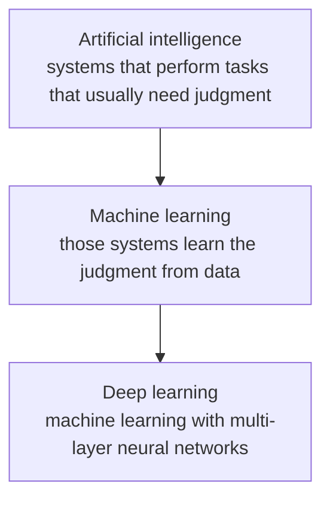
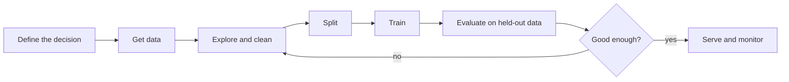

# Fundamentals

Machine learning is the part of artificial intelligence that builds models which improve at a task by fitting patterns in data, instead of a person writing a rule for every case.

A spam filter written as `if "free money" in email` is explicit programming. A spam filter that adjusts itself after seeing thousands of labeled emails is machine learning. The program still has rules, but many of those rules are numbers (weights, thresholds, tree splits) chosen from data.

## Where it sits



- **Artificial intelligence** is the broad goal: software that perceives, predicts, plans, or acts in ways that look intelligent. Search, planning, rules, and learning all count.
- **Machine learning** is the subset that learns a mapping or a structure from examples. The model’s behavior changes when the data changes.
- **Deep learning** is the subset of machine learning that uses neural networks with many layers. It is strong when the raw input is huge and structured, such as pixels, audio samples, or tokens, and when you have enough data and compute to train those layers.
- **Data science** is the wider practice of turning data into decisions. It uses statistics, visualization, domain knowledge, and sometimes a machine-learning model. A chart that shows churn by city is data science. A model that scores each customer’s churn risk is machine learning inside that practice.

Deep learning is not automatically better. A table of a few thousand rows with clear columns is often handled more reliably by a linear model, a tree, or a gradient-boosted tree. Neural networks earn their cost when the features themselves have to be learned (edges in an image, phrases in text).

## What “learning” means

A model is a function with adjustable parameters.

```text
input x  →  f(x; parameters)  →  prediction ŷ
```

Learning is the search for parameters that make `ŷ` agree with what we care about on data we have not memorized.

| Piece | Meaning | House-price example |
| --- | --- | --- |
| Example | One row of experience | One sold house |
| Feature | A measured input | Area, bedrooms, age |
| Label / target | The quantity to predict, when we have it | Sale price |
| Parameter | A number inside the model that training changes | Slope of area, intercept |
| Hyperparameter | A choice we set outside the training update | Tree depth, learning rate, `k` in k-NN |
| Loss | A number that says how wrong the predictions are | Mean squared error |
| Training | Adjusting parameters to reduce loss on the training set | Fitting the line |
| Generalization | Doing well on new examples from the same kind of data | Pricing a house not in the training file |

Parameters and hyperparameters are easy to mix up. The slope of a regression line is learned. The decision to use squared error, or to grow a tree only to depth 6, is chosen by us and checked on held-out data.

## A concrete pass through training

Suppose area alone predicts price, and the model is a line:

```text
ŷ = w · area + b
```

1. Start with a guess, say `w = 0`, `b = 0`.
2. Predict every training house.
3. Measure loss. With squared error, a house predicted at 20 lakh and sold at 50 lakh contributes `(50 − 20)²`.
4. Change `w` and `b` in the direction that reduces that loss. Gradient descent does this with the slope of the loss. A closed-form solver can do it in one shot for plain linear regression.
5. Stop when loss stops improving, or after a set number of passes (epochs).
6. Score the line on houses that were never used to choose `w` and `b`.

If step 6 is skipped, a model can look perfect because it memorized the training file.

## The workflow



1. **Decision.** What will the model output, and what happens if it is wrong? “Flag a transaction for review” is a different product from “block the card automatically.” The cost of a false alarm and the cost of a miss decide the metric before any algorithm is picked.
2. **Data.** Rows are examples. Columns are features and, for supervised learning, a target. Data can be a table, text, an image, a click sequence, or a sensor trace. The model cannot know a fact that was never measured.
3. **Explore and clean.** Look at distributions, missing values, duplicates, leaks, and the unit of each column. Fix problems with rules you could apply to a future row, not with knowledge of that row’s answer.
4. **Split.** Hold out a test set and do not tune against it. Use a validation set, or cross-validation, to compare models. For time-ordered data, the test period must be later than the training period.
5. **Train.** Fit one or more models. Preprocessing that learns from data (a mean, a vocabulary, a selected feature list) is fit on the training fold only, then applied to the rest.
6. **Evaluate.** Use a metric that matches the decision. Accuracy on a 99% legitimate transaction stream can be 99% for a model that never catches fraud.
7. **Ship and watch.** Inputs drift. A model trained on last year’s prices can go stale. Monitoring is part of the system, not a follow-up task.

## Representation

The same fact can be a bad or a good feature.

- A date string `"2024-03-02"` is almost useless as a raw category. Day-of-week, month, and days-since-launch are usable.
- A free-text city name with three spellings of the same city splits one signal into three rare categories.
- A user id with millions of values memorizes people. It does not transfer to a new user unless the model is built for that (embeddings with enough repeats, or features of the user’s behavior).

Most classical machine learning is a bet on the table you build. The algorithm searches for a pattern in those columns. If the column that carries the signal is missing, no algorithm recovers it.

## Libraries you actually use

Language syntax is separate. These are the libraries that show up in a normal Python workflow:

| Library | Role |
| --- | --- |
| NumPy | Arrays, vectorized math, linear algebra |
| Pandas | Tables: filter, join, group, missing values |
| Matplotlib / Seaborn | Plots for exploration and for error analysis |
| Scikit-learn | Splits, preprocessing, classical models, metrics, pipelines |

A **pipeline** ties preprocessing and the model into one object so the same steps run on training data and on a later request. Fitting the scaler inside the pipeline, on training rows only, is the usual way to avoid leaking the test set into the mean and the variance.

Deep learning frameworks (PyTorch, TensorFlow, JAX) matter when you leave classical models. They are not required to train a random forest or a linear model.

## What a model can and cannot claim

- It predicts for data drawn like its training data. A credit model trained in one country is not automatically valid in another.
- Correlation in the table is not a cause. A model can use a proxy (postcode standing in for income) and look accurate while being unfair or brittle.
- High training accuracy is a progress signal, not a result. The result is performance on data the training procedure did not get to fit.
- More data helps when the model is limited by variance or by missing rare cases. More data does not fix a wrong target, a leaked column, or a feature that will not exist at prediction time.
