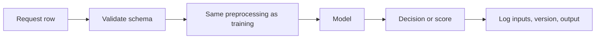

# Deployment and MLOps

A model in a notebook has fit some rows. A deployed model answers requests on rows it has never seen, with the same preprocessing, and keeps doing that after the world drifts. Deployment is the engineering that makes those three things true. MLOps is the habit of versioning, testing, and watching that path so the next retrain is a repeatable change instead of a one-off notebook.

## What you are shipping

You are not shipping a weight file alone. The prediction path includes:

- The exact feature computation, including fills, encoders, and scalers fit on training data.
- The model object.
- The threshold or post-processing that turns a score into a decision.
- The schema: column names, types, and what happens on a missing or new category.

If any of those differ between training and serving, you have **training-serving skew**. A common version: the notebook fills missing age with the training median, and the service fills it with zero. Accuracy in the notebook does not describe that service.

A **pipeline** object that bundles preprocessing and the model, saved together, removes most of this class of bug. The service loads one artifact and calls one transform-then-predict function.



Log the model version, the features you actually fed, and the output. Without that log you cannot explain a bad decision later, and you cannot build a dataset for the next retrain.

## How the model is called

| Style | When it fits |
| --- | --- |
| Batch | Score a file on a schedule. Nightly churn scores, a morning demand forecast. Latency is minutes or hours. Failures can retry |
| Online | Score one request inside a product flow. Fraud check, ranking a feed. Latency is part of the product |
| Streaming | Score a continuous event log with a small delay. Between batch and online |

Batch is the right default when the decision is not needed inside a user request. It is easier to monitor and easier to roll back. Online serving adds a latency budget, a scaling story, and a harder rollback.

## Interfaces

These are application choices, not modeling choices.

- **Streamlit or Gradio** wrap a model in a small interactive app so a person can try inputs. They are a good way to put a model in someone’s hands during review. They are not a substitute for an authenticated production API.
- **Flask or FastAPI** expose prediction as an HTTP endpoint: validate a payload, run the pipeline, return JSON. FastAPI is the usual pick when you want typed request schemas and async workers. Flask is enough for a single synchronous predict function. Either way, the endpoint should refuse a malformed payload, bound the input size, and not return internal traces to the caller.

The service process should load the model at startup, not on every request. Put a timeout around the predict call. Decide explicitly what the product does when the model is down (a default score, a queue, a hard failure). That fallback is part of the design.

Do not log raw secrets, payment data, or more personal data than the retraining pipeline needs. The feature log is a dataset. Treat it as one.

## MLOps

MLOps is the overlap of how models are trained and how software is released. The pieces that matter in practice:

### Version three things together

- **Code** that built the features and trained the model.
- **Data** the model saw, or at least a snapshot id and a query that reproduces it.
- **Model** artifact, with its metrics on the frozen test window.

A metric without the data version cannot be compared to next month’s metric. A model file without the code version cannot be rebuilt when the file format changes.

### Tests that belong in the pipeline

- Schema test: required columns exist, types match, unexpected null rates fail the job.
- Leakage test you can automate: no feature timestamp after the label time, no fit of scalers on the evaluation window.
- Metric test: the new model must beat the current one on the agreed slice, or the promotion stops.
- Smoke test: the loaded artifact scores a fixed row and returns the expected field.
- Distribution test: a feature in the new training data has not jumped to a range the previous model never saw, unless you meant to allow that.

### CI/CD for models

Continuous integration runs those tests when code or scheduled data changes. Continuous delivery promotes an artifact that passed.

A reasonable order:

1. Train in a repeatable job, not in an unsaved notebook session.
2. Evaluate on a window that matches production (the latest time slice, the right groups).
3. Compare to the model that is already serving. Absolute scores are hard to read. The delta is the decision.
4. Deploy to a small fraction of traffic or to a shadow mode that scores but does not act.
5. Promote when live metrics match offline metrics closely enough.
6. Keep the previous artifact so rollback is a configuration change.

Shadow mode catches training-serving skew before users pay for it. The shadow model sees real inputs and its outputs are logged beside the live decision.

### Drift

Two different decays get called “the model got worse.”

- **Data drift:** the inputs moved. A new customer segment, a redesigned form, a sensor recalibrated. The relationship to the label may still hold on regions you still see.
- **Label / concept drift:** the inputs look familiar but the mapping changed. Fraud patterns, a pricing policy, a disease definition. The old decision boundary is aimed at yesterday’s target.

Monitor input distributions (missing rate, mean, category frequencies) even when labels arrive late. Monitor outcome metrics when labels do arrive: precision at the operating threshold, calibration, error by segment. A delay in labels is normal. Build the dashboard for the delay you have, not for an instant accuracy number you cannot compute.

Retrain when the monitored error crosses a line you set in advance, or on a schedule if the series moves steadily (demand models often retrain more often than credit models). Retraining on a window that already includes a broken label process just freezes the break into the next artifact.

### End to end

```text
define target and decision
→ freeze an evaluation window
→ train a versioned pipeline
→ pass schema, metric, and smoke tests
→ shadow or canary
→ serve with logs
→ watch drift and errors
→ retrain from the logged, labeled outcomes
```

The last arrow is why the log exists. A deployed model that does not record what it saw cannot be improved with production experience. It can only be replaced by another offline experiment.

Human review stays in the loop when the cost of a miss is high. The model’s job is then a ranked queue, and the metric that matches deployment is precision in the top of that queue, plus how fast the queue is cleared. Shipping a fully automatic action is a separate decision from shipping a useful score.
