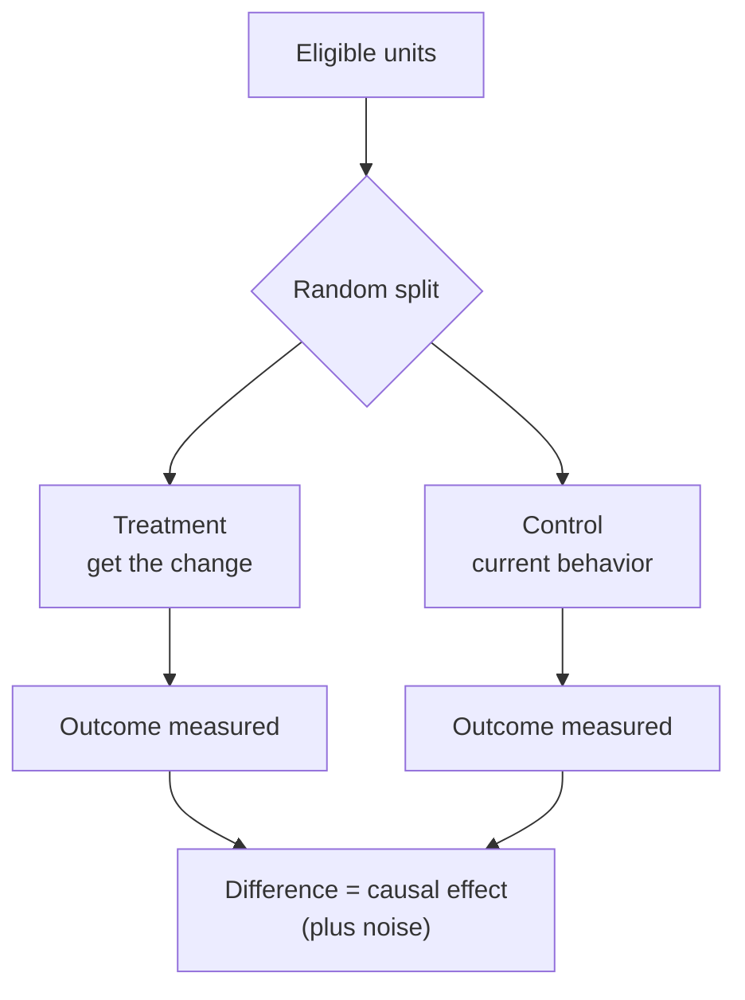

# Causal Inference and Experiments

Prediction and causation are different questions. A model answers “what tends to accompany X?” A decision often needs “what happens **if I do X**?” Every earlier note warns about the gap; this file is about crossing it deliberately, because the careless crossing is where ML systems quietly injure people and businesses.

## Why the difference matters

A churn model learns that customers with a support ticket in the last month churn more. Suppose the retention team then acts as if *triggering* support tickets changes churn. It does not — the ticket is a symptom. The correlation was real, the causal read was not. Removing the ticket column would be even worse: the model now loses its best predictor while the world stays exactly as causal as before.

```text
predicting well  ≠  acting well on the prediction
```

**Confounders** are variables that cause both the feature and the outcome, inventing an apparent link between them. Ice-cream sales and drowning share the confounder “summer.” A data-driven model absorbs confounders happily, because minimizing prediction error has no opinion about the arrow of causation.

Even a perfect observational study can be fooled by **Simpson’s paradox**: a trend that holds in every subgroup reverses when the groups are pooled, because the mixture weights differ. Pooling tests and treatments across hospitals is the classic setting.

## The randomized experiment

A **randomized controlled trial** (in industry: an **A/B test**) is the one design that fixes the causal question by construction. Random assignment makes the treated and control groups exchangeable: any difference in outcomes, beyond sampling noise, is the treatment’s effect.



Design rules that decide whether the test means anything:

- **One primary metric**, chosen before the data arrives, plus guardrail metrics the change must not damage (latency, error rate, complaints).
- **Power before you start.** With typical conversion rates and realistic effect sizes, detecting a small lift takes a large sample. Compute the required sample size and duration first; a test that ends early because it “looks positive” mostly measures noise.
- **Peeking breaks the p-value.** Checking significance every day and stopping when it dips below 0.05 turns a 5% false-positive rate into something far worse. Decide the stopping rule in advance, or use a method built for sequential testing.
- **Randomize by the unit of the decision** (user, account, not each request) and keep the assignment stable across the test.
- **Novelty and primacy effects.** Users reacting to *anything new* inflate early effects; if the behavior is habit-driven, hold through a learning period.
- Run the diagnostic pass: did the two arms actually receive what they were assigned (SRM — sample-ratio mismatch — is the first bug to check), and are the pre-period covariates balanced?

Offline metrics do not settle causal questions, but they set the direction: offline evaluation ([6.model-evaluation.md](./6.model-evaluation.md)) narrows the candidates to the few worth the cost of a live test. A/B testing is expensive; the model evaluation discipline exists so you spend that cost rarely and well.

## Uplift modeling: the model of the *effect*

A response model predicts `P(y | x)`. An **uplift model** predicts the difference the action makes: `P(y | do(treat), x) − P(y | do(no treat), x)`. The goals differ in a way that matters:

- Some customers churn no matter what → intervention wasted.
- Some never churn → intervention wasted.
- Only a segment is **persuadable** — churns unless treated. That is the segment a retention program should spend on.

A plain response model ranks by propensity to churn, which can send your interventions to the “doom loop” segment that no email can save. Uplift shifts the target to the segment where *treatment changes the outcome*.

Common constructions:

- **Two models:** one on treated rows, one on control rows; subtract the predictions. Simple, but the two models’ estimation errors do not cancel — they add.
- **Single model with treatment flag:** add the treatment as a feature and read the coefficient for that interaction. One model, less variance across the split.
- **Transformed outcome / uplift trees:** split on the *difference* rather than the outcome, so the tree itself hunts heterogeneous effects.

Evaluation is the trap. You never observe both outcomes for one person, so there is no per-row ground truth. The honest scores come from a holdout RCT: group predictions into buckets, compare treated-versus-control outcome rates inside each bucket, and summarize with something like Qini. **Never** evaluate uplift with AUC on observed labels — it measures the response model you were trying not to build.

## Reading observational data when no experiment is possible

Sometimes the treatment already happened and randomization is off the table (a pricing change that shipped, a policy already in effect). Methods exist, all built on the same entrance fee: write down the assumptions that make the comparison honest, and defend them.

| Method | Core idea | Trustworthy when |
| --- | --- | --- |
| Difference-in-differences | Changes in a treated group vs a comparable untreated group, around the event | The two groups would have moved in parallel without treatment (check pre-trends) |
| Propensity score matching / weighting | Compare treated and control units with similar probability of being treated, so the comparison is between exchangeable-looking units | Treatment assignment is explained by observed covariates only (**unconfoundedness** — an assumption, not a proof) |
| Regression discontinuity | Treatment assigned by a threshold; compare units just above and just below the line | The threshold is sharp and nobody selects across it |
| Instrumental variables | A variable that moves treatment but has no other path to the outcome isolates the causal effect | You have a defensible instrument, which is rare and worth arguing for |

Each method has a failure you can name — that is their virtue. Parallel trends violated, an unobserved confounder the matching cannot see, a soft threshold players can move around, an instrument that leaks through another path. The habit is to state the threat and check what data lets you check.

Two links back to earlier notes:

- **Off-policy evaluation** in reinforcement learning ([8.reinforcement-learning.md](./8.reinforcement-learning.md)) is the same problem: judging the effect of a policy you did *not* run, from logged behavior you did run.
- **Propensity weighting** recurs in recommender systems ([13.recommender-systems.md](./13.recommender-systems.md)), where exposure — what the previous ranker chose to show — is both a treatment and a bias in the training labels.

## Checklist

- Does the decision need a causal effect, or only a prediction? Say which, in writing, before building.
- Prediction → observational model with the usual discipline. Effect estimation → experiment if at all possible.
- One primary metric and named guardrails; sample size fixed before launch. No peeking.
- For uplift: ground truth is invisible per row; evaluate against a holdout, not AUC on observed labels.
- For observational effects: name the identifying assumption, check the diagnostics it offers, and report what would break it.
- After the change ships, the monitoring discipline of [10.deployment-and-mlops.md](./10.deployment-and-mlops.md) applies — a causal claim that was true last quarter can expire like any other model fit.
