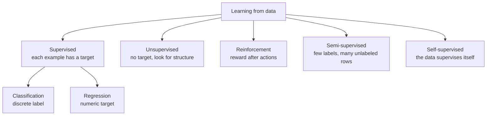

# Types of Learning

The type is defined by **what feedback the training data contains**, not by the brand of algorithm.

| Type | What you are given | What training optimizes | Typical output |
| --- | --- | --- | --- |
| Supervised | Features and a target | Predict the target | A class or a number |
| Unsupervised | Features only | A compact description of the set | Clusters, components, rules |
| Reinforcement | States, actions, rewards | Long-run reward | A policy |
| Semi-supervised | A small labeled set plus a large unlabeled set | Predict the target, using unlabeled rows as extra structure | A class or a number |
| Self-supervised | Raw data, no human labels | Predict a hidden part of the input from the rest | A representation, later fine-tuned |

## Supervised learning

Every training row is a pair `(x, y)`. `x` is the input. `y` is the answer we would want the model to produce. The model learns a function `f` so that `f(x)` is close to `y`, then applies `f` to a new `x` whose `y` is unknown.

Labeled image example: thousands of photos marked cat or dog. The model learns features that separate the two. A new photo is scored as one or the other. Nothing in that procedure works if the training photos have no animal labels and nobody defines what should be predicted.

Two task shapes cover most supervised work.

### Classification

`y` is a category.

- **Binary:** two labels. Spam or not, default or not, disease or not.
- **Multiclass:** one label from three or more. Digit 0–9, topic of a news article.
- **Multilabel:** several labels can be true together. A film can be both comedy and romance. This is not the same as multiclass.

The model often outputs a **score or a probability**. The class is produced by a rule on that score, usually a threshold. Changing the threshold does not retrain the model; it changes the tradeoff between false alarms and misses.

Algorithms that are built for this setting include logistic regression, decision trees, random forests, gradient boosting, k-nearest neighbors, naive Bayes, and support vector machines. Neural classifiers belong here too when the target is a class.

### Regression

`y` is a number on a continuous scale: price, temperature, demand, time-to-failure. The model can still be used for a later decision (“restock if predicted demand exceeds 200”), but the thing it is trained to match is the number.

Linear regression, polynomial regression, ridge, lasso, regression trees, and boosting regressors are the standard tools. Predicting a count or a time-to-event is still “predict a number,” but the loss and the distribution of errors may not be plain squared error.

### When supervised learning is the right frame

Use it when historical outcomes exist and the future decision is “predict this same kind of outcome.” Spam archives with labels, past sales with prices, diagnosed scans with a confirmed finding.

Do not force it when the outcome has never been recorded, when the label is so expensive that you only have a handful, or when the goal is to group customers with no definition of the “correct” group. Those are different types below.

A label that was created by a broken rule teaches the model the broken rule. Supervised learning copies the target you give it, including its mistakes and its biases.

### Where it shows up

- Image, speech, and text: classify a photo, transcribe audio, score the sentiment of a review.
- Forecasting from a table: sales, churn, credit risk, demand. Time order needs a time-aware split even though the task is supervised.
- Ranking and recommendations when you have logged clicks or ratings to learn from.
- Medicine and finance: diagnosis support, fraud scores, credit scores. The operating threshold is a product decision.
- Inspection and control: accept or reject a part from sensor readings.

## Unsupervised learning

Rows have features and **no target**. The algorithm looks for structure you did not name: groups of similar rows, a shorter set of axes, or items that tend to occur together.

Customer purchases with no “segment” column: the algorithm can still group people who buy similar baskets. The group is a hypothesis for marketing, not a ground-truth class, until someone decides the segments are useful.

### Clustering

Put similar rows together.

- **k-means** places `k` centers and assigns each point to the nearest center.
- **DBSCAN** grows clusters from dense regions and can mark isolated points as noise. It does not need `k`.
- **Mean shift** moves points toward dense regions until they settle. The scale of the neighborhood is the main knob.

Clusters are not unique. Change the distance or `k` and the groups change. A cluster has no name until you inspect it.

### Dimensionality reduction

Many columns are redundant or noisy. Reduction builds a smaller set of coordinates that keep the variation you care about.

- **Principal component analysis (PCA)** finds orthogonal directions of greatest variance.
- **Independent component analysis (ICA)** looks for directions that are statistically independent, which is a different goal from “maximum variance.”

These are unsupervised even when you later feed the new coordinates into a supervised model. The reduction step itself never saw the label. Fitting PCA on the whole dataset before splitting still leaks test information into the axes. Fit it on training data only.

### Association rules

In transaction data, find statements of the form “people who buy bread often buy butter,” scored by how often the pair appears and how much the pair beats chance. Apriori, FP-Growth, and Eclat are the classical miners. The output is a rule with support and confidence, not a prediction for one user unless you build that on top.

### When unsupervised learning is the right frame

Use it when labels do not exist, when you are exploring before you know what to predict, or when the product needs segments, a compressed representation, or a shortlist of odd rows.

It is a weak choice when a clear target already exists and is trustworthy. Clustering customers and then hoping the clusters match “will churn” is less direct than training on churn labels if you have them.

### Where it shows up

- Segmentation of customers, products, or documents.
- Anomaly flags: a point far from every dense region.
- Compression before a supervised model, or a plot a person can read.
- Recommendations via “people like you bought this,” when explicit ratings are scarce.
- Cleaning: duplicate groups, redundant sensors, structure you did not know was in the table.

## Reinforcement learning

There is no labeled dataset of correct actions. An **agent** acts in an **environment**, lands in a new **state**, and receives a **reward** (or a penalty). The goal is a **policy**: a way to choose actions that collects more reward over time.

Chess: the agent is not handed the best move for each board. It plays, wins or loses, and has to assign credit to the moves that led there. A single reward at the end of the game is a harder teacher than a label on every move.

| Idea | Meaning |
| --- | --- |
| State | What the agent can observe now |
| Action | What it can do |
| Reward | Immediate feedback, a number |
| Policy | Rule from state to action |
| Return | Discounted sum of future rewards |

Common algorithms:

- **Q-learning** learns the value of taking an action in a state, assuming it acts greedily afterward. It can learn from actions it did not itself prefer (off-policy).
- **SARSA** updates using the action the current policy actually takes next (on-policy).
- **Deep Q-learning** replaces the Q table with a neural network when the state space is too large for a table, such as raw pixels.

Feedback comes in two everyday forms, and the names are easy to swap with everyday English:

- **Positive reinforcement:** add a reward for the behavior you want (points for the right move).
- **Negative reinforcement:** remove an unpleasant signal when the behavior is right (the alarm stops). This is not the same as punishment, which adds an unpleasant signal for a bad action.

### When reinforcement learning is the right frame

Use it when the quality of a decision depends on later decisions, the environment can be interacted with or simulated, and you can define a reward that matches the real goal.

It is a poor fit when a supervised dataset of good actions already exists. Imitating those actions is simpler and usually more stable. It is also a poor fit when the reward is vague: the agent will exploit whatever number you actually coded.

### Where it shows up

- Games and simulations.
- Robots learning a motion with a physical or simulated reward.
- Driving and control, where each action changes the next state.
- Treatment or operations policies, when a simulator or a carefully logged policy can supply feedback.
- Adaptive recommendations, when the system’s choice changes what the user does next.
- Energy and industrial control: setpoints chosen for yield or cost over a horizon.

## Semi-supervised learning

Labeling is expensive. A radiologist can mark a few thousand scans, not fifty million. Semi-supervised training uses a **small labeled set** and a **large unlabeled set** together.

Translation is the usual picture. A few million sentence pairs have human translations. Vast amounts of text in each language have no pair. A model that only uses the pairs ignores most of the language. A model that also learns structure from the unpaired text tends to translate better, as long as the unlabeled text is from a similar domain.

The bet is geometric: points that sit near each other, or that lie on the same smooth region, often share a label. If that bet is false, unlabeled data can spread a wrong label.

### Techniques

- **Self-training.** Fit on the labeled rows. Predict the unlabeled rows. Keep the predictions the model is most sure about as temporary labels. Fit again. Errors in the confident predictions get reinforced, so the confidence cutoff matters.
- **Label propagation.** Build a graph of similar examples. Labels move along edges. A labeled point pulls its neighbors toward its class.
- **Graph-based methods.** Same idea, with an explicit similarity graph and a loss that punishes neighbors that disagree.
- **Co-training.** Two models see different views of the same object (audio and video, or two feature sets). Each labels unlabeled rows for the other. It needs views that are each predictive and not copies of each other.
- **Generative models.** Learn how inputs are produced, sometimes with a generator and a discriminator (a GAN). Synthetic or reconstructed examples can support the decision boundary when labels are scarce. They add a lot of machinery for a gain that is not guaranteed.

### When it is the right frame

Plenty of unlabeled data, few labels, and a reason to believe the unlabeled rows come from the same distribution as the labeled ones. Medical images, speech with a little transcription, text with a few annotated documents, recommendation logs where only some events have an explicit rating.

If the unlabeled pool is a different population (night photos mixed into a daylight dataset, notes from another hospital), it can pull the boundary the wrong way.

### Where it shows up

- Image classification with a small tagged set.
- Language tasks with a little annotation and a lot of raw text.
- Speech with limited transcripts.
- Recommendations with sparse ratings and dense behavior logs.
- Medical imaging with few confirmed diagnoses.

## Self-supervised learning

Nobody writes a label. The training task is built by **hiding part of the input and asking the model to recover it**. The supervision comes from the data itself.

A sentence with a blanked word: the model predicts the word from the context. A photo with a missing patch: the model predicts the patch, or it learns to pull two distorted views of the same photo together and push different photos apart. After this pretraining, the network’s internal features are useful for a real task that does have a few labels (fine-tuning).

This is not the same as semi-supervised learning. Semi-supervised learning still aims at a human label and uses unlabeled rows as extra help. Self-supervised learning invents a pretext task so it can pretrain on raw data.

### Techniques

- **Masked modeling.** Hide tokens or patches. BERT-style text models predict the hidden tokens. The model sees both sides of the blank, so this is a representation learner, not a left-to-right generator.
- **Contrastive learning.** Two augmented views of the same example should match; views of different examples should not. SimCLR and MoCo are standard versions in vision.
- **Autoencoders.** Compress the input to a small code and reconstruct it. The code is forced to keep whatever reconstruction needs. A plain autoencoder can learn little if the task is too easy, so the bottleneck or the corruption has to be real.
- **Predictive coding.** Predict the next chunk of a sequence from the past. Autoregressive language models are this idea at large scale.

### When it is the right frame

Raw data is enormous and labels are scarce or undefined: web text, images, audio, video. The usual product path is pretrain on the pretext task, then fine-tune on a smaller supervised set. If you already have labels for every row and the input is a modest table, a tree or a linear model is the shorter path.

### Where it shows up

- Language models trained by predicting missing or next tokens.
- Vision and speech models pretrained before a small labeled fine-tune.
- Video, where time itself supplies the thing to predict.
- Any large model whose useful behavior starts from a representation learned without manual tags.

## Choosing a type

Ask three questions.

1. Do I have a target for the decision I will make at prediction time?
2. If yes, do I have it on enough rows, or only on a few?
3. Does the correct output depend on a sequence of actions and delayed feedback?

- Target on most rows, and the output is a class or a number: supervised.
- Target on few rows, same kind of unlabeled data available: semi-supervised, often after a self-supervised pretrain when the input is text, image, or audio.
- No target, and you need groups, a compressed view, or odd points: unsupervised.
- No correct action label, but a reward and an environment: reinforcement.

Mixing types is normal. PCA (unsupervised) can feed a classifier (supervised). A self-supervised language model can be fine-tuned with labels. A recommender can be supervised on clicks and still use unsupervised segments. The name of the system is less useful than knowing which step saw a label, which step saw only inputs, and which step saw a reward.
