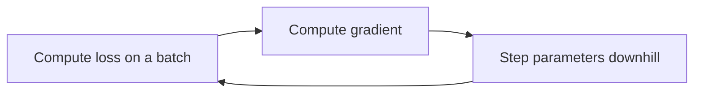

# Mathematics for Machine Learning

The math is there so the update rules and the metrics mean something. You do not need a separate theorem for every model. You do need probability (what a prediction is claiming), statistics (what a sample can support), linear algebra (how a batch of features is stored and combined), and calculus (how training walks downhill on a loss).

## Probability

An **event** is a set of outcomes. A **probability** assigns each event a number from 0 to 1. Disjoint events that cover every outcome have probabilities that sum to 1.

**Conditional probability** is the probability of A once you know B happened:

```text
P(A | B) = P(A and B) / P(B)    when P(B) > 0
```

`P(rain | cloudy)` is not `P(cloudy | rain)`. The first is “how often it rains when it is cloudy.” The second is “how often it is cloudy when it rains.” Classifiers are full of this swap: `P(disease | test)` is the number a patient needs, and `P(test | disease)` is the number a lab study often reports.

**Independence** means `P(A and B) = P(A) P(B)`, or equivalently `P(A | B) = P(A)`. Naive Bayes assumes features are independent given the class. Real features rarely are. The assumption is a modeling choice that makes the estimate possible with little data, not a fact about the world.

### Bayes’ theorem

```text
P(class | x) = P(x | class) P(class) / P(x)
```

- `P(class | x)` is the **posterior**: the belief about the class after seeing the features.
- `P(x | class)` is the **likelihood**: how plausible those features are if the class is true.
- `P(class)` is the **prior**: how common the class is before this row.
- `P(x)` is the evidence. It is the same for every class on a given row, so ranking classes often ignores it.

If fraud is 0.1% of transactions, a detector with a strong likelihood can still be wrong most of the times it fires, because the prior is tiny. Bayes’ theorem is the arithmetic behind that.

### Distributions that models assume

A distribution is a recipe for how a random quantity tends to come out.

| Distribution | Support | Where it appears |
| --- | --- | --- |
| Bernoulli | 0 or 1 | One coin flip; a binary label |
| Binomial | counts of successes in `n` flips | Number of clicks in `n` impressions, if each is independent |
| Categorical | one of `k` labels | Multiclass target |
| Gaussian (normal) | real line, bell curve | Noise in linear regression; Gaussian naive Bayes; clusters in a GMM |
| Poisson | counts 0, 1, 2, … | Event counts in a fixed window, when the mean is moderate and events are rare-ish |

The **expectation** `E[X]` is the long-run average. The **variance** `Var(X) = E[(X − E[X])²]` is the average squared distance from that average. Standard deviation is the square root of variance, in the same units as `X`.

Two features can each vary a lot and still move together. **Covariance** measures that joint movement. **Correlation** rescales covariance to sit between −1 and 1 so the units do not dominate.

### Information theory, the parts training uses

These three quantities are the machinery behind every cross-entropy loss and every tree split.

**Entropy** measures the uncertainty in a distribution. For a class distribution `p₁ … p_k`:

```text
H = − Σ pᵢ log pᵢ
```

A fair coin has entropy 1 bit; a rigged coin has entropy near 0. In this set of notes, entropy appears twice: as the split criterion of decision trees ([5.supervised-learning.md](./5.supervised-learning.md) — *information gain* is the fall in entropy when a node splits), and inside cross-entropy below.

**Cross-entropy** is the average surprise of the truth `y` under the model’s claimed distribution `p`:

```text
H(y, p) = − Σ yᵢ log pᵢ
```

For a binary label that is exactly the log loss in [5.supervised-learning.md](./5.supervised-learning.md). The name explains the shape of the loss: predicting `p = 1` when the truth is `0` costs `−log 0`, infinity. The minimum of cross-entropy over `p` is achieved at `p = y`, which is why “the model should output calibrated probabilities” is not a bolted-on wish — it is what the training objective literally asks for.

**KL divergence** measures how far a distribution `q` is from a reference `p`:

```text
KL(p ‖ q) = Σ pᵢ log (pᵢ / qᵢ)
```

It is zero when the distributions match, positive otherwise, and asymmetric (`KL(p‖q) ≠ KL(q‖p)`), so it is not a distance in the geometric sense. The identity worth keeping:

```text
cross-entropy = entropy of the truth + KL divergence
```

Since the truth’s entropy is fixed, minimizing cross-entropy and minimizing KL divergence are the same task. KL shows up wherever one distribution is being nudged toward another: variational methods, distillation (teacher → student), and policy tuning in reinforcement learning.

The one-line takeaway: **log loss is not an arbitrary formula. It is the surprisal of the labels under the model’s distribution, and minimizing it is asking the model to tell the truth in the probabilistic sense — which is why a well-trained classifier should be calibrated, and why a miscalibrated one is telling you something went wrong.**

## Statistics

Statistics is what you can say about a population after seeing a sample, and how you describe the sample itself.

### Descriptive numbers

For a column `x₁ … xₙ`:

- **Mean:** `(1/n) Σ xᵢ`. Pulled by extreme values.
- **Median:** the middle value after sorting. A few huge salaries do not move it.
- **Mode:** the most frequent value. The useful summary for a category.
- **Percentiles:** the value below which a fraction of the data sits. The median is the 50th percentile.
- **Range, IQR:** max − min, and the gap between the 75th and 25th percentiles. IQR is the usual base for a simple outlier fence.

Skew and kurtosis describe shape, not just location.

- **Skewness** measures asymmetry. Right skew (a long tail of large values) is common in income, prices, and time delays. The mean sits to the right of the median. A log transform is often the first thing to try before a linear model.
- **Kurtosis** measures tail weight relative to a normal bell. Heavy tails mean extreme values show up more often than a Gaussian would predict. Squared-error training treats those extremes as urgent.

A histogram plus a median beats a mean alone on any column you have not plotted.

### Correlation

**Pearson correlation** measures linear association. It is close to 1 when a scatter is a rising straight line, close to −1 for a falling line, and near 0 when there is no linear trend. A U-shape can have Pearson correlation near 0 while the features are strongly related.

**Spearman correlation** ranks both columns first, then applies Pearson to the ranks. It catches monotonic relationships that are not straight lines, and it is less disturbed by a few extreme points.

Correlation is not causation. Ice-cream sales and drowning both rise in summer. A model is allowed to use either as a predictor of the other and will look clever until the season changes. It is also not a substitute for looking at the scatter: one outlier can invent a correlation, and a tight curve can hide from Pearson.

### Inferential ideas

A training set is a sample. A **sampling distribution** is the distribution of a statistic (the mean, a model’s accuracy) if you drew many samples.

The **central limit theorem** says that the average of many independent draws settles toward a Gaussian even when each draw is not Gaussian, under mild conditions. That is why confidence intervals for means often look normal once `n` is decent. It does not say your raw feature is normal.

A **confidence interval** is a range produced by a procedure that, under its assumptions, covers the true value in a stated fraction of repeated samples. A 95% interval is not “the probability the parameter is in this range” for one already-computed interval, unless you are doing Bayesian inference and say so.

A **hypothesis test** asks whether a result this extreme would be rare if a default claim (the null) were true. The **p-value** is that rarity. It is not the probability that the null is true, and it is not the size of the effect. A tiny accuracy gain on millions of rows can be “significant” and still be useless.

In model comparison, a test on the test set that you also used to pick the model is no longer an honest test. Selection uses up the surprise.

## Linear algebra

A **vector** is an ordered list of numbers. One row of features is a vector `x` in `Rᵈ` if you have `d` features. A **matrix** is a stack of vectors. A training set with `n` rows and `d` features is an `n × d` matrix `X`.

The **transpose** `Xᵀ` swaps rows and columns.

The **dot product** of `a` and `b`:

```text
a · b = Σ aᵢ bᵢ = ‖a‖ ‖b‖ cos θ
```

It is large when the vectors point the same way. Cosine similarity ignores length and keeps the angle, which is why it is used for text vectors where document length would otherwise dominate.

A **norm** is a length. L2 is the usual Euclidean length `√(Σ xᵢ²)`. L1 is `Σ |xᵢ|`. Regularization uses these norms on the weight vector, not on the data.

A linear model on one row is a dot product plus an intercept:

```text
ŷ = w · x + b = w₁x₁ + … + w_d x_d + b
```

On a whole batch this is a matrix-vector product. That is why GPUs and NumPy matter: the same multiply applies to every row.

**Matrices as transforms.** Multiplying by a matrix rotates, stretches, or projects vectors. PCA is the search for axes along which that stretch (the variance) is largest. Those axes are eigenvectors, and the stretch factors are eigenvalues. You can use PCA without deriving the decomposition, but the picture explains why components are orthogonal and why the first component carries the most variance.

**Linear equations** `A w = y` are the least-squares problem when an exact solution does not exist. The least-squares solution minimizes `‖Xw − y‖²`. For linear regression with a full-rank design there is a closed form `(XᵀX)⁻¹ Xᵀ y`. In practice libraries use a stabler factorization. The formula fails or becomes unstable when columns are duplicates or near-duplicates (**multicollinearity**): many weight vectors fit equally well, and the individual coefficients swing wildly.

## Calculus and gradient descent

A **derivative** `df/dw` is the slope of `f` at `w`. Positive slope: increasing `w` increases `f`. To decrease `f`, step the other way.

A **partial derivative** is the slope along one coordinate while the others stay fixed. The **gradient** is the vector of all partial derivatives. It points in the direction of steepest increase. Training steps the opposite way.

```text
w ← w − η ∇L(w)
```

`η` is the **learning rate**.



Picture a bowl. The loss is the height. The parameters are your position on the floor. The gradient is the uphill direction. Too large a step jumps over the bottom and climbs the other side. Too small a step crawls. A learning rate that works for standardized features can diverge if features are on huge scales, because the bowl is stretched.

### How much data is in one step

| Variant | Batch | Behavior |
| --- | --- | --- |
| Batch gradient descent | The full training set | Stable direction, expensive step, can sit in a sharp basin |
| Stochastic gradient descent | One row | Noisy, cheap, can escape shallow pits, needs a smaller or decaying step size |
| Mini-batch | A few dozen to a few thousand rows | The default. Noise helps a bit, hardware stays busy |

An **epoch** is one pass over the training set. Mini-batch training takes many updates per epoch.

### Beyond a fixed step

- **Momentum** keeps a running average of past gradients so a consistent downhill direction builds speed and a zigzag cancels.
- **Adam** tracks both a momentum-like average and a per-coordinate scale of recent gradients, then steps further on coordinates that have been quiet. It is the usual default for neural networks. For linear models and trees you often never write this loop yourself.
- **Learning-rate schedules** shrink `η` over time so early steps explore and later steps settle.

Gradient descent finds a local bottom. For a convex bowl such as linear or logistic regression with the standard losses, that bottom is the global one (ignoring numerical issues). For neural networks the surface is not convex; different starts can finish in different places, and “the” minimum is the wrong picture. What matters is a region that generalizes.

**Closed form versus iteration.** Ordinary least squares can jump to the solution. Logistic regression, neural nets, and most other models have no practical closed form, so they iterate. If training loss explodes, the learning rate is the first suspect, then a bug in the target scale, then a missing feature normalization.

### Chain rule, in one line

If loss depends on a prediction and the prediction depends on a weight, the derivative multiplies along that path. Backpropagation is the chain rule applied from the output layer back to the earlier layers, reusing intermediate results so you do not redo the same multiply for every weight. You need that picture only when you are looking inside a neural network. Scikit-learn models hide it.

## What to keep in your head

- A probability is not a score until the model was trained so that the number means a frequency. Many classifiers emit scores that rank well and are still miscalibrated.
- Mean, variance, and correlation describe a sample you should also plot.
- A weight vector times a feature vector is the whole linear model. Scale and collinearity change what those weights mean.
- Training is “move parameters to reduce loss.” The learning rate, the batch, and the shape of the loss decide whether that move works.
