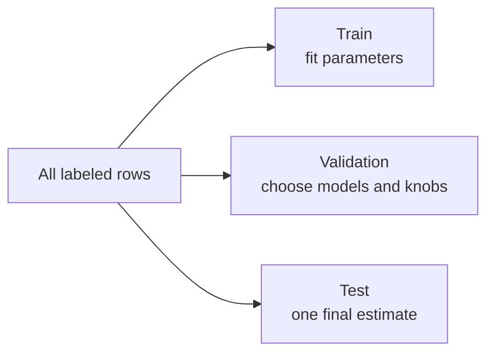

# Data Preparation and Exploratory Analysis

Models fit whatever table you hand them. Preparation is the work of making that table mean the same thing at training time and at prediction time. Exploration is how you find out what the table contains before you trust a score.

## Why preparation dominates the result

A stronger algorithm on a leaked or shifted table loses to a plain model on a clean one. The usual failures:

- A column that will not exist when you predict (the final diagnosis, the refund flag, a timestamp after the event).
- Missing values filled with a statistic computed on the full file, including the test rows.
- Categories seen only in training and a different spelling in production.
- A split that puts the same person, or the future, on both sides.

## Data cleaning

Start by defining one row. Is a row a customer, a transaction, a visit, a sensor minute? Duplicates at the wrong grain inflate accuracy and leak across a random split.

Then:

- Drop or repair columns that are constants, identifiers, or free text you have not decided how to encode.
- Parse dates, numbers stored as strings, and units (grams versus kilograms).
- Decide, in a written rule, what an impossible value means (negative age, a price of zero). Delete it, cap it, or treat it as missing. Do not silently leave it if the model will treat it as real.
- Align the category levels you will accept. New levels at prediction time need a defined bucket (“unknown”), or the pipeline will fail or zero them out.

## Missing values

Missingness is a kind of data, not just a hole.

| Pattern | Meaning | Practical consequence |
| --- | --- | --- |
| MCAR | Missing completely at random | Dropping rows or simple fills distort less |
| MAR | Missingness depends on other observed columns | A fill that uses those columns can be reasonable |
| MNAR | Missingness depends on the missing value itself | The hole carries information. “Income left blank” may itself predict risk |

Fills:

- **Mean or median** for numbers. Median when the column is skewed.
- **Mode** for categories.
- **A dedicated indicator** `was_missing`, plus a fill. The indicator keeps the signal that the value was absent.
- **Model-based fill** (predict the column from the others). Stronger, easier to leak, easier to mis-apply on a later row.

Fit every fill on the training fold only. A test-set mean in the training fill is a small leak that becomes a habit.

Deleting every row with any missing cell is valid when missingness is rare and MCAR. It is harmful when a whole segment systematically leaves a field blank: you train on the people who filled the form.

## Outliers

An outlier is a point far from the bulk. It is not automatically an error.

- **Error:** a sensor glitch, a shifted decimal. Repair or drop.
- **Rare but real:** a whale account, a fraud, a once-a-year peak. Dropping it teaches the model that those events do not happen.
- **A different regime:** two populations in one column. A single model may be worse than a segment plus a model.

Detection is a screen, not a verdict.

- **IQR fence:** below `Q1 − 1.5 IQR` or above `Q3 + 1.5 IQR`. Simple, ignores the other columns.
- **Z-score:** distance from the mean in standard deviations. The mean and the standard deviation are themselves pulled by the outlier, and the rule assumes a roughly symmetric column.
- **Model residual or isolation methods** when “odd” means odd in combination, not odd on one axis.

Squared-error models chase outliers. Absolute-error and tree models are less pulled by one extreme `y`. Transforming a skewed target (log price) often does more than deleting rows.

## Splitting



A common cut is about 60/20/20 or 80/20 with cross-validation inside the 80. The ratio is not sacred. The rules are:

- The test set is touched once, after choices are frozen.
- **Stratify** on the label when classes are uneven, so each split keeps the same class rates.
- **Group** by user, patient, or device if several rows belong to the same entity. A random split lets the model recognize the entity instead of the pattern.
- **Time order** for anything that will be predicted in the future. Train on the past, test on a later window. Shuffling a time series makes tomorrow help predict yesterday.

The validation set estimates generalization while you are still choosing. If you try fifty models and keep the best validation score, that score is optimistic. The test set is the correction, and only if you did not peek.

## Feature scaling

Many models use distances or gradients. A column in the tens of thousands swamps a column in the tenths.

| Method | Formula idea | Use when |
| --- | --- | --- |
| Standardization | `(x − mean) / std` | Linear models, SVM, k-NN, neural nets. Leaves outliers as large z-scores |
| Min-max | stretch onto `[0, 1]` | You need a bounded range. A new extreme at prediction time falls outside the range |
| Robust scaler | subtract median, divide by IQR | Heavy tails, and you still need a scale |

Fit the scaler on the training fold. Apply that same mean and spread to validation, test, and production.

Tree splits do not need scaling. A threshold on income is the same whether income is in rupees or in standardized units. Scaling a tree’s inputs does not hurt much, but it does not fix a bad tree.

## Encoding categories

- **One-hot:** one 0/1 column per level. Right for nominal categories in linear models. High cardinality (thousands of cities) blows up the width and sparsifies the row.
- **Ordinal codes:** integers that follow a real order (low, medium, high). Wrong for unordered categories, because a linear model will treat the code as a magnitude.
- **Target encoding:** replace a level by the mean target of rows with that level. Powerful for high cardinality. It leaks unless the mean is computed out of fold, with smoothing toward the global mean. A rare level’s raw mean is almost a copy of the label.

Unseen levels need a policy: ignore the column contribution, or map to an explicit unknown level that you also created in training by holding some levels out.

## Feature selection, engineering, extraction

**Selection** keeps a subset of existing columns.

- **Filter:** rank columns by correlation, mutual information, or a statistical test, without a full model. Cheap, blind to pairs of features that only work together.
- **Wrapper:** search subsets by training a model on each. Honest and expensive.
- **Embedded:** the model itself shrinks useless weights (L1) or never splits on a column (trees). The selection is tied to that model.

**Engineering** builds columns a person can explain: `debt / income`, hour of day, count of events in the last 7 days, a flag for “field was missing.” Domain ratios often beat a more elaborate algorithm.

**Extraction** builds columns the data defines, such as principal components. You may not be able to name what component 3 means. Extraction is for redundancy and for algorithms that suffer in high dimension, not a default first step on a table of twenty interpretable fields.

Polynomials and interactions (`x²`, `x₁x₂`) let a linear model bend. They also multiply the chance of fitting noise. Regularization or a tree, which already splits on interactions, is the comparison to make.

## Imbalanced classes

If 1% of rows are the positive class, a model that always says negative is 99% accurate and useless.

Handle the decision and the training separately.

- **Metric:** precision, recall, F1, average precision, or cost-weighted error. Accuracy hides the failure.
- **Threshold:** train on probabilities, then pick the cutoff on validation data for the cost you actually pay.
- **Class weight:** penalize mistakes on the rare class more during training.
- **Resampling:** oversample the rare class, undersample the common class, or synthesize rare neighbors (SMOTE-style methods). Resample the training fold only. A synthetic point must not be built using test rows, and evaluation must stay on the natural class rate or the metric will lie.
- **More real positives** beat synthetic ones when you can get them.

## Exploratory analysis

EDA is a set of questions, not a pile of charts.

1. How many rows and columns, and what fraction is missing?
2. What is the type and the unit of each column?
3. How is the target spread? Class rates, or the shape of a numeric target?
4. Which features move with the target?
5. Which features move with each other (redundancy, leakage)?
6. What changed over time?

### Univariate, bivariate, multivariate

- **Univariate:** one column. Counts, mean, median, histogram, bar chart, box plot.
- **Bivariate:** two columns. Scatter for two numbers, box plots of a number by a category, a stacked bar for two categories, correlation for a pair.
- **Multivariate:** three or more. A correlation heatmap, a pair plot on a few columns, color on a scatter, or a model-based importance after a simple baseline. You cannot see ten dimensions directly. Reduction and conditioning (plot this pair inside one segment) are the tools.

### Plots that earn their place

| Plot | What you learn |
| --- | --- |
| Histogram or density | Shape, skew, separate modes, absurd spikes at 0 or at a sentinel |
| Bar chart | Category frequencies, including a level that is almost everyone |
| Box plot | Median, spread, tails, by group |
| Scatter | Trend, curvature, clumps, a few points driving the relationship |
| Time plot | Drift, seasonality, a gap in collection |
| Correlation heatmap | Linear redundancy. Read it with the scatters, not instead of them |
| Target versus feature | Whether the column is worth a model at all |

### Correlation analysis

Compute Pearson for linear pairs and Spearman when order matters more than a straight line. Then ask:

- Is a very high correlation with the target too good? The column may be a leak (a later measurement, a restatement of the label).
- Are two features near-duplicates? A linear model will split credit between them and look unstable. A tree will pick one.
- Does a near-zero correlation clear the feature? Only if you expected a straight line. Check a binned plot before you drop it.

### A slightly deeper pass

Once the basic plots exist, the useful extra checks are:

- **Segments.** The overall trend can reverse inside a group (a feature helps in one region and hurts in another).
- **Stability.** A relationship that holds only in one month will not survive deployment.
- **Error slices after a baseline.** Fit a simple model, then plot residuals by segment. EDA does not stop when training starts. The residuals are a new column.
- **Leakage probes.** For each tempting column, write when it becomes known. If that time is after the prediction, drop it even if the chart looks perfect.

## Order of operations

```text
define the row and the target
→ inspect raw distributions
→ fix types, duplicates, impossible values
→ split
→ fit fills, scalers, encoders, and any selection on the training side only
→ look again at the training fold
→ train
→ slice errors on the validation fold
```

Exploration on the full file is fine for spotting data bugs. Every number you **learn** and reuse (mean, encoder, chosen columns, chosen threshold) comes from training data alone.
