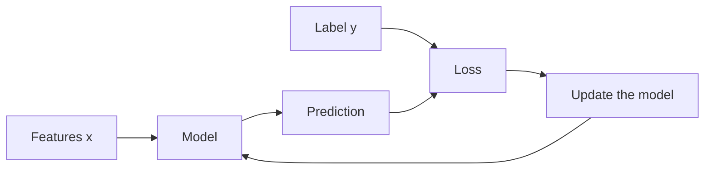
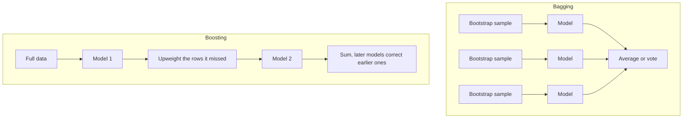

# Supervised Learning

Supervised models learn `f(x) ≈ y` from labeled rows. The split inside this family is the kind of `y`.



| | Classification | Regression |
| --- | --- | --- |
| Target | A class | A number |
| Model output | A class, or a score you threshold | A number |
| Typical losses | Log loss, hinge loss | Squared error, absolute error |
| Typical metrics | Precision, recall, F1, ROC-AUC, log loss | MAE, RMSE, R² |

## Kinds of features

- **Nominal:** categories with no order. City, color, product type.
- **Ordinal:** categories with an order but uneven gaps. Rating “low / medium / high.”
- **Discrete numeric:** counts. Bedrooms, number of logins.
- **Continuous numeric:** measurements. Area, temperature, latency.

The type decides the encoding. It does not by itself decide the algorithm.

## Linear regression

A linear regressor predicts a weighted sum:

```text
ŷ = w · x + b = w₁x₁ + … + w_d x_d + b
```

With one feature this is a line. With many features it is a flat plane in higher dimension. “Linear” means linear in the **weights**, not that the world is a straight line. If you add a feature `x²`, the curve in `x` bends and the model is still linear in its weights.

### Loss

**Mean squared error**

```text
MSE = (1/n) Σ (yᵢ − ŷᵢ)²
```

Large errors dominate because they are squared. That is desirable when a big miss is truly much worse, and harmful when one bad row should not swing the fit.

**Mean absolute error** sums `|yᵢ − ŷᵢ|`. The fit stays closer to the median behavior and is less bullied by extremes. The gradient is less smooth at zero error.

Training chooses `w` and `b` to minimize the chosen loss. For MSE there is a closed-form least-squares solution when the columns are well behaved. Gradient descent reaches the same bowl.

### What the coefficients mean

With standardized features, a larger `|wⱼ|` means feature `j` moves the prediction more. With raw features, the coefficient depends on the unit: a weight on income-in-rupees is tiny beside a weight on a 0/1 flag, even when income matters more. Compare coefficients after scaling, or compare effects in original units on purpose (“one more bedroom, holding the other columns fixed”).

Holding the other columns fixed is the interpretation, and it is false when those columns always move together. Multicollinear features make the individual weights unstable even when predictions stay fine.

### Assumptions, and what breaks if you ignore them

For **prediction**, the practical requirements are:

- The target is roughly a linear function of the features you provided, possibly after transforms.
- The training rows resemble the rows you will score later.
- No feature is a copy of the target or a future fact.

For **interpreting coefficients and standard errors**, classical theory also wants independent errors, roughly constant error spread (homoscedasticity), and no perfect collinearity. Normal errors matter for those interval estimates more than for the point prediction. A fan-shaped residual plot means the raw MSE fit is spending too much attention on the high-variance region. A log target or a different model is the next experiment, not a claim that the theorem failed in the abstract.

### Multiple and polynomial regression

**Multiple linear regression** is the same model with several features. **Polynomial regression** adds powers and products as extra features. Degree 3 on ten raw features is a different, much larger model. Use a validation curve. If training error falls and validation error rises, the polynomial is memorizing.

### Regularized linear models

When many features can fit noise, shrink the weights.

- **Ridge (L2):** add `λ Σ wⱼ²`. Weights get small but usually not exact zeros. Stabilizes collinear features by sharing credit.
- **Lasso (L1):** add `λ Σ |wⱼ|`. Can set weights to exactly zero, so it also selects features. With correlated features it tends to keep one and drop the others, somewhat arbitrarily.
- **Elastic net:** both penalties. Useful when you want sparsity but features come in correlated groups.

`λ` is chosen on validation data, never by the training loss alone. A larger `λ` means a simpler model. The intercept is not usually penalized.

## Logistic regression

Despite the name, this is a **classifier**. It models the probability of a class, not a continuous price.

Pass the linear score through a **sigmoid** so it lands in `(0, 1)`:

```text
z = w · x + b
P(y = 1 | x) = 1 / (1 + e^(−z))
```

```text
probability
1.0 |                ________
    |            __--
0.5 |        __--
    |    __--
0.0 |__--
    +------------------------ z
```

The class is `1` when the probability is at least a threshold, default `0.5` only if false positives and false negatives cost the same.

### Loss

Squared error on probabilities is a bad fit here: the surface is not the friendly bowl linear regression enjoys, and confident wrong answers are not punished sharply enough. **Binary cross-entropy** (log loss) is the standard:

```text
L = − (1/n) Σ [ yᵢ log pᵢ + (1 − yᵢ) log(1 − pᵢ) ]
```

If the true label is 1 and the model says `p = 0.01`, `log(p)` is a large negative and the loss is large. Predicting exactly 0 or 1 for the wrong class sends the loss to infinity, which is why implementations clip probabilities.

For more than two classes, softmax replaces the sigmoid: each class gets a score, and the scores are normalized into probabilities that sum to 1. Training uses categorical cross-entropy.

### Reading the weights

`z` is a **log-odds**. Increasing feature `j` by one unit multiplies the odds `p / (1 − p)` by `e^(wⱼ)`, if the other features stay fixed and the feature is on that scale. A positive weight raises the probability of class 1. The same collinearity warning as in linear regression applies.

Logistic regression is a linear **boundary** in the feature space: the set of points where `z = 0` is a flat cut. If classes wrap around each other, you need other features (interactions, kernels, trees, a neural net) or the linear cut will underfit.

Class weights or a changed threshold handle imbalance. The model can estimate a rare event; a default threshold of 0.5 can still never fire if every predicted probability sits at 0.02.

## Decision trees

A tree asks a sequence of yes/no questions. Each leaf holds a prediction: the majority class, or the average target, of the training rows that landed there.

```text
            area > 1200?
           /            \
        no              yes
        /                 \
  bedrooms > 2?        price ≈ high mean
   /        \
no           yes
cheap mean   mid mean
```

### How a split is chosen

The tree searches features and thresholds to make the child nodes **purer** than the parent.

- **Gini impurity:** `1 − Σ pₖ²`. Zero when the node is a single class. Fast default.
- **Entropy:** `− Σ pₖ log pₖ`. Zero when the node is pure.
- **Information gain:** entropy of the parent minus the weighted entropy of the children.

Gini and entropy usually grow similar trees. Neither is a reason to prefer a tree over another algorithm.

For **regression trees**, purity is replaced by error inside the node. A split is good when it reduces the variance (or absolute deviation) of `y`. The leaf predicts the mean (for squared error) of its rows.

### Why trees overfit, and what limits them

An unstopped tree can isolate single training rows and get training error near zero. That tree has memorized IDs of leaves, not a stable rule.

Controls:

- Maximum depth.
- Minimum rows required to split or to form a leaf.
- Minimum improvement in impurity.
- **Pruning:** grow, then cut branches that do not help validation error.
- Ensembles, below, which are usually more effective than a single heavily tuned tree.

Trees handle mixed feature types, ignore monotone scaling, and model interactions by asking follow-up questions. They extrapolate badly: outside the range of the training features, a regression tree predicts a constant (the nearest leaf), not a continuing slope. They are unstable: a small data change can replace the root split and rearrange everything under it. Ensembles exist because of that instability.

## k-nearest neighbors

k-NN stores the training set. To predict a new row, it finds the `k` closest training rows and votes (classification) or averages them (regression). There is no learned weight vector. The training set **is** the model. This is a lazy learner: work happens at prediction time.

```text
k = 1  →  copy the nearest label (noisy)
k large →  a smoother vote that can wash out a small class
```

Distance is usually Euclidean after scaling. Without scaling, the feature with the largest unit defines “near.” Other distances: Manhattan (L1), cosine for sparse vectors such as text counts.

### Decision boundary

With `k = 1` the boundary is a jagged mosaic around individual points. As `k` grows, islands disappear and the boundary gets smoother. If `k` equals the whole training set, every query gets the global majority class.

Choose `k` on validation data. For binary votes, an odd `k` avoids a tie. Weights can decay with distance so a far neighbor counts less than a near one.

k-NN suffers in high dimension: distances between points become less informative when every point is far from every other point (the curse of dimensionality). It is also slow and memory-heavy at prediction unless you add an index. It is a strong baseline on small, well-scaled problems, and a poor default on wide sparse tables.

## Naive Bayes

Bayes’ theorem with a strong simplifying assumption: **features are independent given the class.**

```text
P(class | x) ∝ P(class) · Πⱼ P(xⱼ | class)
```

The prior `P(class)` is the class frequency. Each `P(xⱼ | class)` is estimated from the column values inside that class. Multiplying is legal only under the independence assumption. When features are copies of each other, naive Bayes double-counts that evidence and becomes over-confident. It can still rank classes well.

Variants differ in how they model `P(xⱼ | class)`:

| Variant | Feature assumption | Typical data |
| --- | --- | --- |
| Gaussian | Continuous, bell-shaped within each class | Measurements |
| Multinomial | Counts | Word counts, event counts |
| Bernoulli | Binary presence or absence | Word appears or not, symptom flags |

**Laplace smoothing** adds a small count so a feature value that never appeared with a class does not force the whole product to zero. Without it, one unseen word can veto a class.

Naive Bayes is fast, works with little data, and is a standard text baseline. It is not the model you pick when feature dependence is the signal (two lab tests that mean something only together) unless you build combined features yourself.

## Support vector machines

A linear SVM looks for the **widest margin** between two classes: the slab around the decision boundary that stays empty of training points. The points that touch the slab are the **support vectors**. The other points do not change the boundary. That is the geometric difference from logistic regression, which is influenced by every row through the likelihood.

**Soft margin** allows some points inside the slab or on the wrong side, controlled by `C`.

- Large `C`: punish violations hard, a tighter fit, more risk of overfitting.
- Small `C`: a wider, simpler margin, more training mistakes tolerated.

**Hinge loss** is the training objective’s point of view: no penalty once a point is beyond the margin on the correct side, and a linear penalty as it crosses. Logistic regression never fully ignores a point.

### Non-linear SVM and kernels

When a flat cut is wrong, the **kernel trick** computes similarity as if the points were mapped into a higher-dimensional space, without writing that space down.

- **Linear kernel:** the original flat cut.
- **Polynomial kernel:** interactions up to a chosen degree.
- **RBF (Gaussian) kernel:** local similarity. It can draw complex boundaries and can also wrap itself around noise if `C` and the kernel width are loose.

Scale features before an RBF or linear SVM that uses L2 geometry. Probabilities are not the native output. A score’s distance from the boundary ranks points; turning it into a calibrated probability needs an extra model fit on held-out scores.

Multiclass SVMs are built from several binary SVMs (one-versus-rest or one-versus-one).

## Ensemble methods

One tree is unstable. A combination of many models often has lower error than any member, if the members are not all the same.



### Bagging

**Bootstrap aggregating** draws many samples with replacement from the training set, fits a model on each, and averages the predictions (or votes). Averaging cancels uncorrelated mistakes.

Bagging mostly **reduces variance**. It helps unstable learners, especially deep trees. It does little for a model that already has high bias, such as a shallow linear fit: the copies all share the same blind spot.

**Out-of-bag error:** each tree skips the rows that were not drawn into its bootstrap sample. Scoring those rows gives an internal error estimate. It is useful, and it is not a substitute for a final time-based or grouped test set.

### Random forest

A random forest is bagging of trees plus one more source of disagreement: at each split, the tree may consider only a random subset of features.

That extra randomness makes the trees less alike, so the average cancels more error. It also makes a single dominant feature less able to appear at the root of every tree, which spreads importance and reduces correlation among trees.

- Classification: majority vote, or averaged class probabilities.
- Regression: average of the trees’ numeric predictions.
- Knobs: number of trees, depth, minimum leaf size, number of features tried per split.

More trees improve the average until it plateaus. They do not cause the overfitting that a deeper single tree causes. Depth and leaf size still control how wild each tree is. Feature importance can be read from how much a feature reduces impurity, with the caveat that correlated features share or steal that credit.

Forests handle non-linearities and interactions, need little scaling, and are hard to beat on medium tabular data. They are weaker when the signal is a very smooth linear trend in a few features, where a regularized linear model is simpler and can extrapolate.

### Boosting

Boosting fits models **in sequence**. Each new model focuses on what the current sum gets wrong. The final prediction is a weighted sum of the members.

Boosting mostly **reduces bias**. It can turn shallow trees (weak learners) into a strong model. It can also overfit if you add too many stages or let each stage fit too hard. The learning rate (shrinkage) and the number of stages are the main controls: a smaller learning rate with more stages is the usual stable setting.

| Method | What each new model does |
| --- | --- |
| AdaBoost | Reweights training rows, giving more weight to those the previous ensemble misclassified. Weak learners are often stumps (one-split trees) |
| Gradient boosting | Fits the next tree to the **residuals** (the gradient of the loss) of the current ensemble. Works for regression and classification losses |
| XGBoost, LightGBM, CatBoost | Gradient boosting with sharper regularization, smarter tree growth, and engineering for speed and missing values. CatBoost is built to handle categories with less manual encoding |

Use a validation set to stop adding trees (**early stopping**) when validation loss stops improving. Boosting is often the strongest off-the-shelf method on structured tables. It is more sensitive to label noise than a random forest, because later trees chase the rows that still look wrong, and some of those rows are wrong for bad reasons.

### Bagging versus boosting

- Bagging: models in parallel, aim at variance, deeper trees are acceptable.
- Boosting: models in series, aim at bias, shallow trees plus many rounds is the usual setup.
- If the single model already overfits, try bagging or stronger regularization before boosting harder.
- If the single model is too crude, boosting is the more direct fix.

## Neural networks, only as far as supervised learning needs

A neural network stacks linear scores and **non-linear activations**. Without a non-linearity, a stack of layers collapses into one linear model.

```text
input → linear → activation → linear → activation → output
```

Common activations: ReLU (`max(0, z)`) in hidden layers, sigmoid for one probability, softmax for several classes. Training is mini-batch gradient descent on cross-entropy or squared error, using backpropagation.

Width and depth let the model represent curved boundaries and interactions, provided you have enough data. On a modest table, a boosted tree is usually a better first model. Networks become the default when the input is an image, a waveform, or a token sequence and the features should be learned rather than hand-built.

Pieces that decide whether training works:

- Feature scale, or normalization layers.
- Learning rate.
- Regularization: weight decay, dropout, early stopping, data augmentation.
- A validation curve so extra epochs stop when they only memorize.

Vanishing gradients, attention, and architecture search belong to deep learning ([11.deep-learning.md](./11.deep-learning.md)). The supervised fact to keep is that a network is still a function `f(x)` trained to match `y`, judged on held-out data, and capable of memorizing a training set that is small relative to its size.

## Picking a supervised model

Start from a baseline you can explain.

1. Majority class, or the training mean of `y`. Any real model must beat this.
2. Linear or logistic regression with cleaned features. If this wins, you have earned a simple system.
3. A random forest or gradient boosting as the non-linear tabular comparison.
4. k-NN or naive Bayes when the data is small, local, or text-count shaped.
5. A neural network when the raw signal is spatial or sequential.

Judge the comparison on a validation scheme that matches deployment (grouped, stratified, or time-based), with a metric from the next notes, not on training error.
