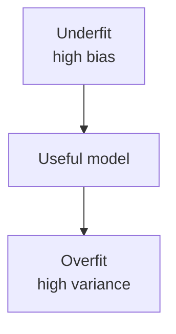

# Model Evaluation and Optimization

A model is finished when you can say how it behaves on data it did not fit, under the costs you actually pay. Training loss is the tool for fitting. It is not that statement.

## Confusion matrix

For a binary decision, every test row falls in one cell. Call the class you care about detecting the **positive** class.

|  | Predicted positive | Predicted negative |
| --- | --- | --- |
| Actual positive | True positive (TP) | False negative (FN) |
| Actual negative | False positive (FP) | True negative (TN) |

```text
                 predicted
                 +        -
actual +        TP        FN
actual -        FP        TN
```

- **TP:** caught a real positive.
- **FP:** false alarm.
- **FN:** missed a real positive.
- **TN:** correctly left a negative alone.

Fraud, cancer, and spam swap which mistake is expensive. The matrix makes you count both. A single accuracy number adds the diagonal and hides the mix.

```text
Accuracy  = (TP + TN) / (TP + TN + FP + FN)
```

Accuracy is the right headline only when classes are balanced and the two errors cost about the same. On a 1% positive rate, always predicting negative scores 99%.

## Precision, recall, and F1

```text
Precision = TP / (TP + FP)     of the alarms, how many were real
Recall    = TP / (TP + FN)     of the real positives, how many you caught
Specificity = TN / (TN + FP)   of the real negatives, how many you left alone
```

- High precision, low recall: few alarms, many misses. A spam folder that almost never hides a real mail, and also lets a lot of spam through.
- Low precision, high recall: you catch almost every positive and also flag many negatives. A screening test that sends many healthy people to a second look.

**F1** is the harmonic mean of precision and recall:

```text
F1 = 2 · precision · recall / (precision + recall)
```

The harmonic mean stays low if either number is low. F1 treats precision and recall as equally important. If they are not, use a weighted cost or pick the threshold from the cost, and report precision and recall at that threshold instead of chasing F1.

For multiclass problems, compute the matrix as one-versus-rest per class, then average:

- **Macro:** each class counts equally, even rare ones.
- **Weighted:** each class counts in proportion to its size.
- **Micro:** pool TP, FP, and FN across classes. Micro-F1 matches accuracy when every row has one class.

## Thresholds, ROC, and precision–recall

Most classifiers emit a score. The matrix exists only after you pick a cutoff.

Lower the cutoff: recall rises, precision usually falls. There is no universal best cutoff. It belongs to the product.

**ROC curve:** plot true-positive rate (recall) against false-positive rate (`FP / (FP + TN)`) as the cutoff moves. The diagonal is a useless ranker. A curve that bows toward the top-left ranks positives above negatives.

**AUC-ROC** is the area under that curve. It equals the probability that a random positive receives a higher score than a random negative. It does not depend on one threshold. It can look excellent when positives are rare, because false-positive *rate* stays small while the number of false alarms is still large.

**Precision–recall curve** and its area (**average precision**) answer the question you have under imbalance: among the rows I might act on, how often am I right, and how many positives do I cover? Prefer it when the positive class is rare.

**Log loss** punishes confident mistakes. Two models with the same hard labels can have very different log loss if one is calibrated and the other is brash. **Calibration** means “when I say 0.8, the event happens about 80% of the time.” Ranking can be good while calibration is bad. If you will show a probability or threshold at 0.3 because you believe it means 30%, check a reliability plot and recalibrate on validation data if you must.

## Regression metrics

```text
MAE  = (1/n) Σ |yᵢ − ŷᵢ|
MSE  = (1/n) Σ (yᵢ − ŷᵢ)²
RMSE = √MSE
```

MAE is in the units of `y` and matches a typical absolute miss. RMSE is also in those units but reacts more to large misses. Report RMSE if a big error is operationally worse. Do not compare RMSE across targets that have different scales.

```text
R² = 1 − (Σ (yᵢ − ŷᵢ)²) / (Σ (yᵢ − ȳ)²)
```

R² is the fraction of variance relative to predicting the mean. It is 1 for a perfect fit and 0 for a model no better than the mean. It can be negative on a test set. A high R² on a target that is easy to predict (tomorrow’s temperature from today’s) can still be a bad product if the remaining error is the part you needed.

**Adjusted R²** shrinks R² as you add features that do not help. It is a check on stuffing the linear model, not a test-set metric to optimize directly.

**MAPE** (mean absolute percentage error) divides by `y` and breaks when `y` is zero or near zero. Use it only when a percentage error is the real business quantity and the target stays away from zero.

Always plot residuals `y − ŷ` against the prediction and against important features. Structure left in the residuals is signal the model did not use, or a split of the data where it fails.

## Validation

| Scheme | What it does | When it lies |
| --- | --- | --- |
| Hold-out | One train / validation / test cut | The cut is unlucky or too small |
| k-fold | Rotate which fold is held out, average the scores | Rows are not independent |
| Stratified k-fold | Each fold keeps the class rate | You needed grouping or time order instead |
| Group k-fold | An entity never appears in two sides | You ignored the grouping column |
| Time-series split | Train on a prefix, test on the next block, roll forward | You shuffled |

`k` is often 5 or 10. Larger `k` means a bigger training piece and a noisier per-fold score. Average the metric. Also look at the spread across folds. A model that is excellent on four folds and fails on one is telling you about a segment.

Nested validation is the clean version of “tune, then estimate”: an inner loop chooses hyperparameters, an outer loop estimates the error of that selection process. If the dataset is small and you skip it, at least keep a final test set you did not tune on.

**Data leakage** is any path that lets the answer, or the test distribution, influence training.

- Scaling or encoding fit on all rows.
- Target encoding without an out-of-fold mean.
- A feature computed with a future timestamp.
- Duplicate rows landing on both sides.
- Selecting features using the test labels.
- Tuning until the test score looks good, then publishing that same test score.

## Overfitting, underfitting, bias and variance



- **Underfitting:** training error is already poor. The model is too rigid, the features lack the signal, or training stopped too early. Adding data does not fix a model that cannot represent the pattern.
- **Overfitting:** training error is low and validation error is much higher. The model fits sample noise. More data, fewer features, a simpler model, or stronger regularization usually help.
- **Bias:** error from a model class that cannot express the real pattern, even with infinite data. A line fit to a clear curve.
- **Variance:** error from the model changing when the training sample changes. A deep tree, k-NN with `k = 1`.

```text
expected error ≈ bias² + variance + irreducible noise
```

The noise term is the labeling slop and the unmeasured factors. No model removes it. Pushing training error toward zero once you are near that floor is how you start fitting noise.

**Learning curves** plot training and validation error against training-set size.

- Both errors high and close: add features or a more flexible model.
- A wide gap, validation error still falling as `n` grows: get more data, or regularize.
- A wide gap that does not close: the model can memorize, and more of the same rows may not be enough if they repeat the same patterns.

## Regularization

Regularization adds a preference for simpler parameters so the fit cannot use every wiggle.

| Method | Effect |
| --- | --- |
| L2 / ridge / weight decay | Small weights, all features can remain |
| L1 / lasso | Some weights driven to zero |
| Elastic net | Mix of both |
| Tree constraints | Shallow trees, large leaves |
| Dropout | Randomly ignore units during neural training so no unit can memorize alone |
| Early stopping | End training while validation loss is best, before the later epochs memorize |
| Data augmentation | Train on distorted copies so the label is tied to the stable content |

The regularization strength is a hyperparameter. It is legal to make training loss worse in exchange for a better validation loss. That trade is the point.

## Hyperparameters and model selection

**Parameters** are learned from the training fold (weights, tree structure, k-means centers).

**Hyperparameters** are chosen by us using validation performance: depth, `k`, `C`, `λ`, learning rate, number of trees.

Search strategies:

- **Grid search:** try every combination on a list. Fine when the list is short. Wasteful when one knob does not matter and another needs a fine range.
- **Random search:** sample combinations. Better when only a few hyperparameters actually move the metric. You can also sample learning rates on a log scale.
- **Successive halving / Bayesian optimization:** spend more evaluations on settings that already look good. Worth it when one training run is expensive.

Compare models only under the same split and the same metric. A forest with a lucky split is not “better” than a linear model with an unlucky one. Fix the split (or average many) before you rank algorithms.

Selection checklist:

1. Baseline first.
2. One metric, chosen for the decision, plus the metric you must not wreck (recall at a fixed precision, for example).
3. Same preprocessing policy for every candidate, fit inside the fold.
4. Report the validation mean and spread, then a single test number once.
5. Keep the simplest model that is close to the best. A 0.2 point F1 gain that costs a system nobody can debug is often a loss.

## Error analysis after the score

A metric says how large the problem is. Slices say where it lives.

- By class, by segment, by time, by confidence bucket.
- The false positives: are they one confused category?
- The false negatives: are they the rare subtype you care about?
- Residuals against a feature you thought was handled.

The next change should answer a slice, not a generic urge to try another algorithm. Sometimes the fix is a feature, a label correction, or a threshold. Sometimes it is a different model. The slice tells you which.

## Explaining a model’s decisions

Everyone downstream of the score — the reviewer, the audited customer, the operator — will ask *why*. There are model-native answers and model-agnostic answers; the honest ones come with caveats.

### Model-native importance

- **Linear coefficients:** meaningful after standardizing features, and unstable under collinearity ([5.supervised-learning.md](./5.supervised-learning.md)).
- **Tree impurity importance:** how much a feature reduced Gini/entropy across all splits. Free in every implementation, but biased toward high-cardinality features and blind to whether a feature helps on held-out data. Correlated features share or steal credit.

### Permutation importance

Fit the model, then for one feature, shuffle its column on held-out data and measure how much the score falls. The fall is the feature’s worth *for that model on that data*.

Advantages: model-agnostic, computed on validation data (so it can reveal a feature that training statistics overrated), and directly tied to the metric you care about. Caveats: correlated features mask each other (shuffling one while its twin still stands barely dents the score), and it works per feature, not per prediction.

### SHAP

SHAP attributes one prediction by asking how the score changes as features are added in every order, then averaging the credits fairly. Output: per prediction, a signed contribution per feature, summing to the prediction minus the baseline.

- Use it for the decisions where a *why* is owed: why this loan was declined, why this row was flagged. Aggregate the per-prediction attributions and you get global importance that respects the trained model.
- Caveats: it explains the **model**, not the world, and it explains the model that exists, leaks included. A leaked feature can light up with huge SHAP values; that is a finding about the model, not a reason to trust it. It is also approximate in practice (sampling of feature orders), and slow on big models unless you use the framework-specific fast paths.

### Partial dependence and friends

- **Partial dependence** sweeps one (or two) features over their range, averages the model’s prediction, and traces the mean response. **Individual conditional expectation (ICE)** draws one curve per row instead, so an averaging-induced flat line (the classic symptom: a U-shaped effect that partial dependence hides) shows up as crossing curves.
- All of them assume the swept feature can vary while other columns stay as they are. For correlated features that joint state is rare in reality — the plot can show the model answering on inputs that do not occur. Read them next to the bivariate plots from [4.data-preparation-and-eda.md](./4.data-preparation-and-eda.md).

### Rules of interpretation

1. An explanation is a claim about the **model**, and the model’s claim about the world is only as good as its data and its split.
2. Report at the level the audience needs: global importance for the team, per-prediction attribution for the reviewer.
3. Where a decision affects a person, the honest output is usually: main factors, their direction, and what would have changed the decision (a counterfactual) — evaluated on held-out data, same as any other claim in these notes.
