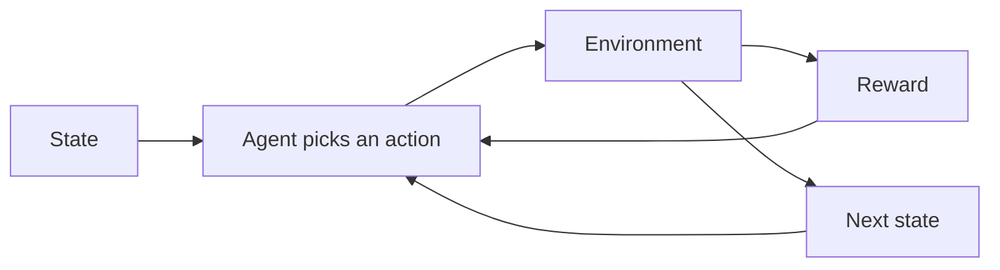

# Reinforcement Learning

Supervised learning copies a target. Reinforcement learning does not receive the correct action. An agent tries actions, the world changes, and a reward arrives. The thing being learned is a **policy**: what to do in each situation so that the total reward over time is large.



Chess again: the state is the board, the action is a legal move, and the reward might be 0 until a win or a loss at the end. The agent has to decide which earlier moves deserved credit for that final reward. That **credit assignment** problem is why this is harder than labeling each position with the best move.

## The pieces

| Piece | Meaning |
| --- | --- |
| Agent | The learner and decision maker |
| Environment | Everything the agent does not control. It applies the action and returns the next situation |
| State | The information the decision is based on |
| Action | A choice available in that state |
| Reward | A number received after the action. You design this |
| Episode | A run from a start state until a terminal state |
| Policy `π` | A distribution over actions given the state. The behavior |
| Return | The discounted sum of rewards from now on |
| Value | Expected return from a state, or from a state-action pair, if you follow a policy |

The **discount** `γ` is between 0 and 1.

```text
Return = r₁ + γ r₂ + γ² r₃ + …
```

`γ` near 0 cares about the next reward only. `γ` near 1 cares about the distant future. Discounting keeps the sum finite and expresses impatience or uncertainty about the far future.

**Positive reinforcement** adds a reward for a desired action. **Negative reinforcement** removes something aversive when the action is right. **Punishment** adds a negative reward for a bad action. These are facts about the reward function you code. An agent does not understand “punishment” as a concept. It increases the probability of behavior that raised return.

## Markov decision processes

An MDP is the formal environment.

- A set of states.
- A set of actions.
- A transition model `P(next state | state, action)`.
- A reward function `R(state, action)` or `R(state, action, next state)`.
- A discount `γ`.

The **Markov** property says the next state and reward depend only on the current state and action, not on the rest of the history. If your state omits something that matters (a pedestrian hidden from the last frame, a battery level you forgot to include), the decision problem is not Markov in the state you actually stored, and the agent looks inconsistent. Fix the state before you blame the algorithm.

A policy can be deterministic (`this state → this action`) or stochastic (a probability over actions). Stochastic policies are necessary when the best behavior is mixed, and they are a natural way to keep exploring.

## Value and the Bellman equation

The **state value** `V(s)` is the expected return from state `s` if the agent follows a given policy afterward.

The **action value** `Q(s, a)` is the expected return from taking action `a` in `s`, then following the policy.

Bellman’s idea: the value of being here equals the immediate reward plus the discounted value of where you land.

```text
V(s) = E[ r + γ V(s') ]
Q(s, a) = E[ r + γ maxₐ' Q(s', a') ]     for the optimal Q
```

The second line is the **optimal** action-value equation. The best action in `s` is the one with the largest `Q(s, a)`. The equations are recursive. Solving them is the whole of value-based reinforcement learning.

**Planning versus learning.** If you already know `P` and `R`, you can compute values by planning, with no further interaction. If you do not know them, you have to sample them by acting. Model-based methods learn or use a model of the transitions. Model-free methods learn a policy or a value function from experience alone.

## Value iteration

When the transition model and the reward are known and the state space is small enough to table, **value iteration** solves the optimal value.

1. Initialize `V(s)` arbitrarily (0 is fine), and set terminal states to 0.
2. Sweep every state and update

```text
V(s) ← maxₐ Σₛ' P(s' | s, a) [ R(s, a, s') + γ V(s') ]
```

3. Repeat until the largest change in `V` is tiny.
4. Read the policy off the values: in each state, pick the action that maximizes the right-hand side.

Each sweep applies the Bellman optimality backup. Under the standard conditions it converges to the optimal value, and the greedy policy on that value is optimal.

**Policy iteration** alternates two steps: evaluate the current policy (compute its `V`), then improve the policy by acting greedily on that `V`. It also converges for finite MDPs, often in fewer iterations, with a heavier evaluate step.

These algorithms are exact on small grids and toy games. They do not scale to raw pixels. They are how you check that you understand an MDP before you approximate.

## Exploration and exploitation

If the agent always takes the action that looks best so far, it may never try the action that is actually better. If it always explores, it never uses what it knows.

**ε-greedy:** with probability `ε`, take a random action; otherwise take the best known action. Decay `ε` over time so the agent explores early and settles later. The weakness is that the random actions are uniformly random, including actions already known to be terrible.

Optimistic initialization and bonus rewards for rarely seen states are other ways to push the agent into unfamiliar regions. The principle is the same: uncertainty should attract visits until the estimate is good.

## Q-learning

Q-learning learns `Q(s, a)` from sampled transitions, without knowing `P`.

After observing `(s, a, r, s')`:

```text
Q(s, a) ← Q(s, a) + α [ r + γ maxₐ' Q(s', a') − Q(s, a) ]
```

`α` is the learning rate. The term in brackets is the **temporal-difference error**: the gap between the old estimate and a one-step lookahead.

The `max` is taken over the next actions even if the behavior policy did not choose that next action. Q-learning is **off-policy**. It learns the optimal action values while the agent is free to explore with a different behavior, such as ε-greedy. That separation is useful. It is also why Q-learning can be optimistic: the `max` prefers noisy high estimates, and early noise gets locked in.

Store `Q` as a table when the state and action sets are small (grid world, short discrete histories).

## SARSA

SARSA is the same idea with one change. The update uses the **next action that was actually taken**, `a'`, not the max:

```text
Q(s, a) ← Q(s, a) + α [ r + γ Q(s', a') − Q(s, a) ]
```

The name is the tuple it needs: state, action, reward, next state, next action.

SARSA is **on-policy**. It evaluates the policy that is generating the behavior, including that policy’s exploration. Near a cliff, ε-greedy Q-learning can learn the optimal path that walks along the edge, because the `max` assumes no future random steps, and then fall off during the random steps it still takes. SARSA learns the value of a policy that does take those random steps, so it often prefers a safer path. If you will deploy the greedy policy with exploration turned off, Q-learning matches that deployment. If you will keep exploring, SARSA matches the policy you are actually running.

## Deep Q-learning

A table cannot hold every camera image. **Deep Q-networks** represent `Q(s, a)` with a neural network. The update targets from the Bellman equation become regression targets for the network.

Two practical pieces keep the fit from chasing a moving target with correlated frames:

- **Experience replay:** store transitions and train on a random minibatch. This breaks the correlation of consecutive frames and reuses rare events.
- **Target network:** compute the `max Q(s', a')` target with a copy of the network that updates slowly. The regression target stays still for a while.

The action space for a basic DQN is discrete and small. Continuous actions (a steering angle, a torque) need a different method, usually a policy gradient or an actor-critic that can output a real number.

Reward scale still matters. A network does not fix a reward that is 0 everywhere except one rare spike.

## Policy-based methods

Value methods learn `Q` and act greedily. **Policy methods** learn the policy parameters directly. That handles stochastic policies and, with the right head, continuous actions.

### REINFORCE

REINFORCE runs a whole episode with the current policy, then increases the probability of actions that were followed by a high return and decreases the probability of actions followed by a low return.

```text
policy parameter step ∝ (return from this step) · (gradient of log probability of the action taken)
```

The return is a noisy estimate of how good the action was. Variance is high, because a lucky later reward credits every earlier action. Subtracting a **baseline** (often a learned value of the state) keeps the direction and reduces the noise. The baseline version is the one people actually run.

REINFORCE is on-policy. After you update, the old episode was generated by a policy you no longer have, so you collect new episodes. It is simple and slow on hard problems.

### Actor-critic

An **actor** is the policy. A **critic** estimates a value function. The critic’s temporal-difference error replaces the full Monte Carlo return as the signal for the actor. Updates can happen at every step instead of at the end of the episode, and the variance drops.

**A3C** (asynchronous advantage actor-critic) runs several actors in parallel copies of the environment, each updating a shared model. The parallel streams decorrelate experience the way replay does, without a single replay buffer. **Advantage** means “how much better this action was than the critic’s average for the state,” which is the baseline idea.

Later relatives (A2C, PPO, SAC) change how conservative the policy update is. The idea to keep: a learned value function judges the action, and the policy is updated from that judgment. PPO in particular limits how far the policy may move in one update, because a single large step from a noisy advantage can collapse behavior.

## Designing the reward

The agent optimizes the number you wrote, not the story you meant.

- A robot rewarded for forward speed may fall and twitch because twitching scores velocity.
- A trading agent rewarded for profit with no risk term may take ruinous bets.
- A sparse reward (only +1 at the goal) makes learning slow because almost every episode looks the same: zero.
- A dense shaping reward can speed learning and can also create a shortcut that ignores the goal.

**Reward shaping** adds hints. It is safe when the extra reward cannot change which policy is optimal, and unsafe when the agent can farm the hint forever. If you can supervise the correct action directly, do that. Reinforcement learning earns its cost when the good behavior is defined by consequences, not by an available label.

## What to check before trusting an agent

- Is the state Markov enough? Write down what the agent cannot see.
- Does a random policy already collect some reward? If every episode is identical zeros, the learning signal is missing.
- Does the metric you plot match the return you train? People tune for episode reward and ship a system that exploits a simulator bug.
- Can you solve a tiny version with value iteration or a table? If the small MDP is wrong, the large network will faithfully learn the wrong problem.
- Simulation is not the world. Policies overfit simulators. Domain randomization and a final evaluation in the real setting are part of the method, not a demo detail.

On-policy methods need fresh data from the current policy. Off-policy methods can reuse old transitions and must be careful about how far the behavior that collected the data sits from the policy being learned.
