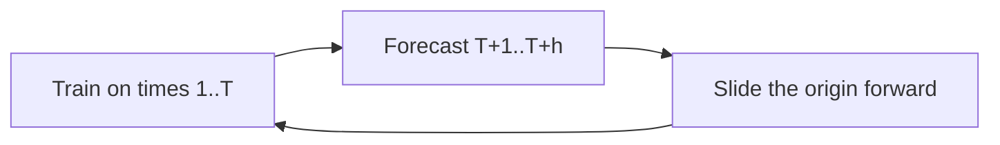

# Time Series and Forecasting

A time series is a sequence of measurements in time order: daily sales, hourly load, a sensor each minute. The order is the structure. A random train-test split destroys it, because the model then trains on Tuesday to predict Monday and looks more accurate than any deployment will be.

Forecasting means predicting future values from the past, sometimes with extra known columns (a planned promotion, a holiday calendar, the weather you are willing to assume).

## What a series is made of

```text
series = trend + seasonality + remainder
```

- **Trend:** a long movement up or down. A product gaining users over years.
- **Seasonality:** a repeating pattern with a known period. Weekday retail, summer electricity, a yearly festival.
- **Remainder:** what is left. Some of it is noise. Some of it is a shock you might explain with an external event.

A series can have more than one season. Hourly traffic often has a daily cycle and a weekly cycle. Plot the series before you name the period. A histogram of the raw values hides the order. A line chart is the first plot, then the same chart aggregated by hour-of-day or month-of-year.

**Lag features** turn forecasting into a supervised row: predict `y_t` from `y_{t-1}`, `y_{t-7}`, rolling means that end at `t-1`, and anything else known at forecast time. A rolling mean that includes `y_t` is leakage.

## Stationarity

A series is **stationary** when its statistical behavior does not depend on the clock: the mean, the variance, and the way values relate across lags stay constant. A series with a strong trend or a changing seasonal amplitude is not stationary.

Many classical models assume stationarity. If the assumption fails, the model treats a one-time level shift as a pattern it can repeat.

**Differencing** replaces `y_t` with `y_t − y_{t-1}`. A steady slope becomes a roughly flat series. **Seasonal differencing** uses `y_t − y_{t-s}` for period `s`. You difference enough to remove trend and season, and no further. Over-differencing invents structure and makes the forecast harder to explain.

A unit-root test such as the **Augmented Dickey-Fuller** test asks whether a series still behaves like a random walk. A small p-value is evidence against a unit root, in the direction of stationarity. The test is a check, not a picture. A series can pass a test and still have a variance that grows, or fail because of a single break a transform would handle. Look at the differenced plot.

Taking logs before differencing helps when the swings grow as the level grows (sales that bounce by a percentage, not by a fixed amount).

## Autocorrelation

**Autocorrelation** at lag `k` is the correlation of the series with itself shifted by `k` steps.

- **ACF** (autocorrelation function): correlation at each lag, including indirect effects. A strong lag-1 correlation creates a shadow at lag 2 even when the direct lag-2 link is weak.
- **PACF** (partial autocorrelation): the correlation at lag `k` after accounting for the lags in between. It is the tool for spotting a direct memory of a given length.

How you use them for ARIMA is below. The immediate use is simpler: if lag 7 is large in daily data, last week matters, and a model that only sees yesterday is incomplete.

## Exponential smoothing

Smoothing forecasts by averaging the past, with recent points weighted more.

**Simple exponential smoothing** is enough for a series with no trend and no season:

```text
level_t = α y_t + (1 − α) level_{t-1}
forecast  = level_t
```

`α` near 1 tracks noise. `α` near 0 is a slow average. Fit `α` on past time, do not grid-search it against a shuffled error.

**Holt’s method** adds a trend component with its own smoothing weight. **Holt-Winters** adds a seasonal component, either additive (a fixed-size bump each December) or multiplicative (a December that scales with the current level). Multiplicative seasonality matches series whose seasonal swing grows with the trend.

These methods are small, fast, and strong baselines. A learned boosting model on lag features should have to beat Holt-Winters, not beat a naive guess alone.

The **seasonal naive** forecast — “next Monday equals this Monday,” or “next December equals last December” — is the baseline underneath that. If your model cannot beat seasonal naive, it is not using the history.

## ARIMA

**ARIMA(p, d, q)** combines three ideas on a series you are willing to treat as stationary after differencing.

| Letter | Name | Role |
| --- | --- | --- |
| `p` | Autoregressive order | `y_t` depends on the previous `p` values |
| `d` | Differencing order | How many times you difference before the ARMA part |
| `q` | Moving-average order | `y_t` depends on the previous `q` forecast errors |

```text
AR:   y_t = c + φ₁ y_{t-1} + … + φ_p y_{t-p} + error_t
MA:   y_t = c + error_t + θ₁ error_{t-1} + … + θ_q error_{t-q}
```

ARIMA uses the differenced series inside that ARMA structure, then undoes the difference to forecast the original scale.

Reading ACF and PACF on the **already differenced** series:

- PACF cuts off after lag `p`, ACF tails off: an AR(`p`) story. The partial correlations die once the direct memory is included.
- ACF cuts off after lag `q`, PACF tails off: an MA(`q`) story. Shocks linger a fixed number of steps.
- Both tail off: a mixed model. Try small `p` and `q`. Large orders fit noise.

Information criteria (AIC, BIC) compare fitted orders on the training window. They do not replace a later time-based error. `d` is chosen to reach stationarity, usually 0, 1, or 2, not by AIC on a menu of over-differenced series.

ARIMA assumes a linear dependence and a fairly stable variance. It does not know about a promotion next week unless you move to a version with external regressors (ARIMAX). It forecasts a smooth return toward its mean behavior. It will not invent a regime change it has never seen.

## SARIMA

**SARIMA** adds seasonal copies of the same three knobs: seasonal AR, seasonal difference, and seasonal MA, at period `s`.

A weekly retail series might be differenced once for trend and once at lag 7 for the week, with a small non-seasonal AR and a seasonal MA. The notation is longer. The idea is not: there is memory at short lags and memory at the seasonal lag, and both can be AR-like or MA-like.

Seasonal differencing plus a non-seasonal ARIMA is sometimes enough and is easier to explain. Add the seasonal AR and MA terms when the residuals of that simpler model still show a spike at the seasonal lag.

## How to evaluate a forecast



- **Walk-forward (rolling origin):** fit using only data before the origin, score the next horizon, move the origin, repeat. This is the honest estimate.
- **Horizon matters.** A model can be excellent one day ahead and useless thirty days ahead. Report the error at the horizon you will actually use.
- **Metrics:** MAE or RMSE in original units. MAPE only if zeros are absent and a percentage is the business language. Compare against seasonal naive on the same origins.
- **Refit policy:** some systems refit every day, some freeze coefficients for a month. The validation should copy that policy.
- **Prediction intervals.** A point forecast without a range overstates certainty. Intervals from a model that assumed constant variance are too narrow exactly when the series is stressed. Check how often the real value falls inside the interval on past origins (coverage), not only the average error.

## Features and models beyond ARIMA

When you have many related series (every store, every product) or rich external drivers, a supervised model on lag features is often the production system:

- Lags, rolling means, rolling standard deviations, all computed with information available at forecast time.
- Calendar: hour, day of week, month, holiday, days to the next known event.
- Identifiers of the series, so one model can share strength across stores while still learning a store effect.
- A time-aware split, and no scaling fit on the future.

Gradient boosting on these tables is a standard modern baseline. Sequence neural networks are justified when the history is long and the pattern is not well summarized by a few lags. They still need a walk-forward test. A neural net that shuffled time will post a flattering error and fail on the next month.

## Practical checks

- Missing timestamps are not the same as a zero measurement. Decide which one you have. Forward-filling a gap can invent a flatline the model will trust.
- Outliers and stockouts: a zero-sales day because the item was unavailable is not a demand of zero. If you train on it, you forecast the stockout.
- Changing period: a company that starts a new promotion calendar will break a seasonal model until that season has been observed.
- Hierarchy: forecasts of items should be looked at next to the forecast of the total. Independent item models can sum to a nonsense total unless you reconcile them.
- Drift: monitor error by week. A rising error with a stable training score is a series that left the old regime, which is the usual way forecasting systems die.
